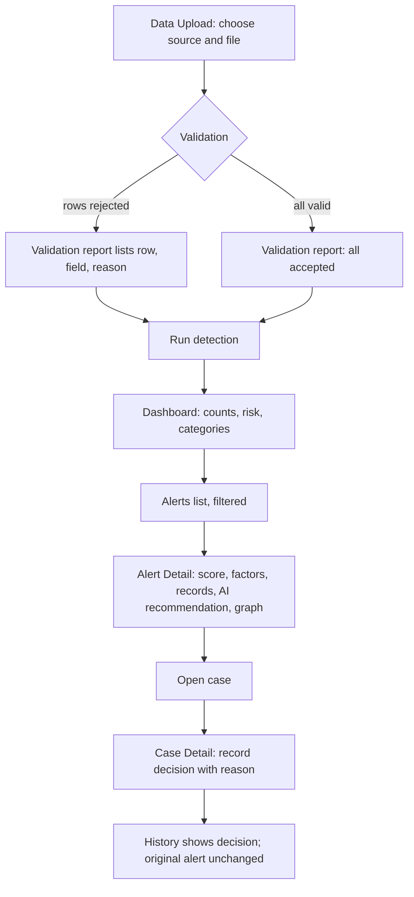

# User Flow: Digital Fraud Investigation System

Inputs: `ideation/intent-capture/intent-statement.md`, `ideation/scope-definition/scope-document.md` (sequencing and value stream), `ideation/scope-definition/intent-backlog.md`. Answers: `rough-mockups-questions.md` Q2, Q3, Q7.

## Core Flow: Upload to Decision (Q2)


<!-- Text fallback: Data Upload goes to validation. Rejected rows are listed in the report; otherwise all are accepted. Either way the investigator runs detection, sees the dashboard, filters the alerts list, opens alert detail with score, factors, records, AI recommendation and graph, opens a case, records a decision with a reason, and the history shows the decision while the original alert stays unchanged. -->

```
Flow: Upload to decision
Persona: Fraud investigator
Trigger: New data from lending, insurance or core banking systems
Steps:
  1. Data Upload -> picks source and file (or sample data) -> validation report with accepted, rejected, warnings
  2. Data Upload -> clicks Run detection -> detection, risk scoring and AI review run
  3. Dashboard -> clicks a highest-risk alert -> Alert Detail opens
  4. Alert Detail -> reads score, factors (with points), AI recommendation, records, graph
  5. Alert Detail -> clicks Open case -> Case Detail opens with evidence copied read-only
  6. Case Detail -> selects decision and types reason -> clicks Record decision -> history line added
Success outcome: decision recorded in history; original alert still shows its first classification
Error paths:
  - unreadable file -> "Could not read this file" -> choose another file; name kept
  - every row rejected -> report with reasons; Run detection disabled with explanation
  - AI unavailable -> "AI review unavailable; rule-based score shown" -> investigation continues
  - save fails -> message keeps typed reason -> retry
```

## Supporting Flow: Reveal a Masked Value (Q7)

```
Flow: Reveal masked value
Persona: Supervisor
Trigger: Needs the real name or number to act on a case
Steps:
  1. Case Detail -> clicks Reveal next to a masked value -> value shown for this view
  2. System -> adds "Value revealed" line to case history and Data Safety recent reveals
Success outcome: value visible to the supervisor; reveal recorded
Error paths:
  - not a supervisor -> Reveal not shown at all
```

## Supporting Flow: Review AI Activity

```
Flow: Review AI activity
Persona: Investigator or supervisor
Trigger: Wants to see what the AI did and what it saw
Steps:
  1. AI Activity Log -> scans calls by alert, step, model, tokens, latency, cost
  2. AI Activity Log -> expands a row -> sees the masked text that was sent to the model
Success outcome: every AI step is visible, with no unmasked PII
Error paths:
  - spend near $10 limit -> warning banner at 80 percent
  - call failed -> row shows "Failed, rule-based result kept" with reason
```

## Assumptions & Open Questions

- [assumption] Detection, risk scoring and AI review run together when the investigator clicks Run detection; whether AI review runs in the background after alerts appear is a design decision for later stages.
