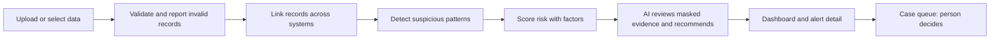

# Scope Document: Digital Fraud Investigation System

Inputs: `ideation/intent-capture/intent-statement.md` (problem, success metrics, AI role), `ideation/feasibility/feasibility-assessment.md` (viability, timeline risk), `ideation/feasibility/constraint-register.md` (TC, OC and RC constraints). Answers: `scope-definition-questions.md` Q1–Q6.

## Minimum Viable Scope

This first version delivers the full Level 1 journey, with hybrid AI decisions inside it (Q1):

1. Ingest and validate customer and account profiles, transaction batches, and device and login logs, from CSV, Excel and JSON files, reporting every invalid record.
2. Link records across lending, insurance and core banking through shared customer, account, application, device and transaction identifiers.
3. Detect the four required scenarios (suspicious transfers, shared devices, repeated login failures, legitimate lookalikes) plus at least one extra (suspicious loan applications or duplicate insurance claims).
4. Score risk from several indicators and explain the factors behind each level.
5. Show an alert dashboard: processed records, flagged events, risk distribution, fraud categories, filters by customer, transaction, product, risk level, date and detection type, and an alert detail view.
6. Run a case queue in which a person records an initial decision, while the original alert stays unchanged.
7. Hybrid AI decisions on flagged alerts, with in-app AI logs.
8. Visible PII masking.
9. A deployed public URL for the jury.

## In Scope (MoSCoW)

| Priority | Capability | Source |
|---|---|---|
| Must | Level 1 journey (items 1–6 above) | Q1, Q2 |
| Must | PII masking, visible in the app | Q2; intent statement success metrics |
| Must | Deployed public URL for the jury | Q2; constraint OC-05 |
| Must | Hybrid AI decisions on flagged alerts: category, bounded risk adjustment, recommendation citing records | Q2; intent statement "How AI Takes Part" |
| Must | In-app AI logs and observability | Q2; intent statement success metrics |
| Should | MCP server for Claude and other frontier models, with consent before every write | Q2 |
| Could | Visual link graph of related customers, devices, accounts, applications and claims | Q2 |
| Could | Draft suspicious-transaction report for a case | Q2 |
| Could | Investigator feedback that tunes the rules | Q2 |

## Out of Scope (Won't, this version)

| Capability | Why | Source |
|---|---|---|
| mTLS / zero-trust networking between services | Keeps the product simple and deployment-ready | Q2; constraint TC-04 |
| Langfuse and separate observability services | Observability stays inside the app | Q2; constraint TC-04 |
| Real integrations with Azentio or core-banking systems | Challenge rules allow synthetic data only; adapters keep the door open | Q2; constraints TC-02, RC-01 |

## Dependencies

- Ingestion and the common data model come first. Detection depends on them, risk scoring on detection, alerts and cases on risk, and the dashboard on alerts. (Q3)
- Hybrid AI decisions depend on alerts and on PII masking. (Q3)
- The MCP server depends on the app's own operations and the consent step. (Q3)
- Deployment depends only on the app being runnable. (Q3)

## Sequencing

Value-first along the judged path (Q4):

1. A thin end-to-end slice that is deployed and accepts an upload.
2. Detection, risk scoring, the dashboard and the case queue.
3. Hybrid AI decisions and in-app AI logs.
4. The MCP server.

## Value Stream Map

<!-- Text fallback: Upload or select data, then validate and report invalid records, then link records across systems, then detect suspicious patterns, then score risk with factors, then AI reviews masked evidence and recommends, then the dashboard and alert detail, then the case queue where a person decides. -->

Each step hands an investigator something they used to gather by hand. The time saved is in steps B to F, which today happen across separate screens (intent statement, problem statement).

## Timeline and Scope Risk

- Milestone 1 has 3 hours. (Q5)
- The feasibility assessment estimates the Level 1 journey alone at about 2.5 hours. Adding hybrid AI makes milestone 1 a stretch.
- The team chose to keep everything in milestone 1 and accept the risk of not finishing. (Q6)
- Following the sequence above keeps a working, judged journey available as early as possible, even if AI lands late.

## Assumptions & Open Questions

None.
