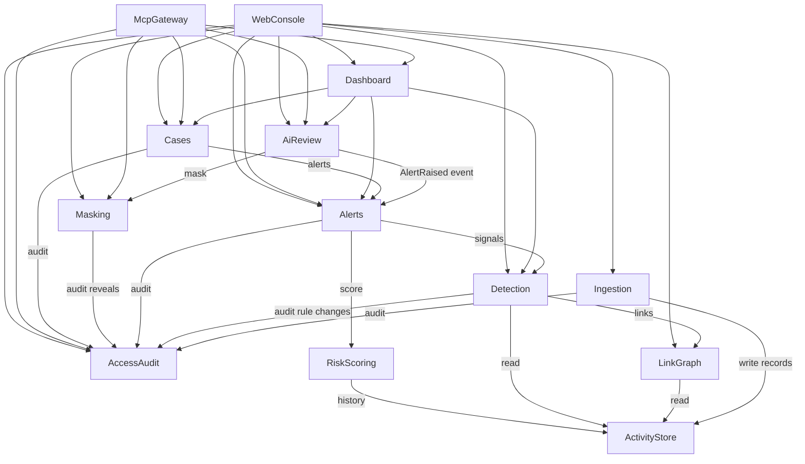

# Component Catalogue

Inputs: `inception/requirements-analysis/requirements.md` (FR1–FR12), `inception/user-stories/stories.md` (US1.1–US11.1), `inception/practices-discovery/team-practices.md`. Answers: `domain-design-questions.md` Q1–Q4.

```yaml
components:
  - name: ActivityStore
    summary: Common data model for activity from lending, insurance and core banking
    behaviour: >
      Holds validated records in one model. Source identifiers are stored as opaque strings,
      exactly as given. Money is a fixed-point INR decimal, never floating point. Timestamps
      carry their time zone. Records are only added by Ingestion; detection reads them.
    responsibilities:
      - Store customers, accounts, transactions, devices, logins, beneficiary changes, loan applications, insurance claims
      - Answer customer-history queries (past amounts, payees, devices)
    depends_on: []
    dependents:
      - component: LinkGraph
        interaction: read records to build links
      - component: Ingestion
        interaction: write validated records
      - component: Detection
        interaction: read records for rules
      - component: RiskScoring
        interaction: read customer history for mitigation
    external_dependencies:
      - name: PostgreSQL (Supabase)
        kind: database
        purpose: persistent storage of activity records
    entities:
      - name: Customer
        identifier: customerId
        attributes: [customerId, name, dateOfBirth, phone, email, address, identityNumber, onboardedAt, sourceSystem]
      - name: Account
        identifier: accountId
        attributes: [accountId, customerId, product, openedAt, status]
        references:
          - entity: Customer
            owned_by: ActivityStore
            relationship: each Account belongs to one Customer
      - name: Transaction
        identifier: transactionId
        attributes: [transactionId, timestamp, senderAccountId, beneficiaryAccountId, beneficiaryName, amountInr, channel, status, deviceId, note]
      - name: Device
        identifier: deviceId
        attributes: [deviceId, firstSeenAt]
      - name: LoginEvent
        identifier: eventId
        attributes: [eventId, customerId, timestamp, deviceId, ipAddress, location, outcome, eventType]
      - name: BeneficiaryChange
        identifier: changeId
        attributes: [changeId, customerId, payeeAccountId, changedAt]
      - name: LoanApplication
        identifier: applicationId
        attributes: [applicationId, customerId, appliedAt, amountInr, deviceId, ipAddress, phone, address, disbursementAccountId, status]
      - name: InsuranceClaim
        identifier: claimId
        attributes: [claimId, policyId, customerId, incidentDate, claimDate, claimType, amountInr, description, payoutAccountId]

  - name: AccessAudit
    summary: Roles, server-side permission checks and the audit trail
    behaviour: >
      Resolves the active role (Analyst, Investigator, Supervisor) from the role switcher and
      decides whether a role may perform an action. Refuses anything not allowed, regardless
      of channel (app or MCP). Appends an audit entry for every action and refusal; entries
      are never edited. Never writes unmasked PII into an entry.
    responsibilities:
      - Permission decisions per role and action
      - Append-only audit trail
    depends_on: []
    dependents:
      - component: Ingestion
        interaction: authorise and audit uploads
      - component: Detection
        interaction: authorise and audit rule changes
      - component: Alerts
        interaction: audit detection runs
      - component: Masking
        interaction: authorise and audit reveals
      - component: Cases
        interaction: authorise and audit decisions
      - component: McpGateway
        interaction: authorise and audit MCP calls
      - component: WebConsole
        interaction: read role and audit trail
    entities:
      - name: AuditEntry
        identifier: auditId
        attributes: [auditId, timestamp, role, channel, action, target, result]

  - name: Ingestion
    summary: Loads CSV, Excel and JSON files, maps columns, validates and reports
    behaviour: >
      Parses files with safe settings and a size limit. Maps columns through a per-source
      mapping held in configuration. Validates mandatory fields, types, formats, allowed values
      and duplicate keys; the first record with a key is accepted and later duplicates are
      rejected. Unknown references are warnings, not rejections. Every rejected record is kept
      with its reasons; nothing is silently dropped.
    responsibilities:
      - Parse and map files for five source types
      - Validate and produce the validation report
      - Keep rejected records
    depends_on:
      - component: ActivityStore
        interaction: write accepted records
        style: sync
      - component: AccessAudit
        interaction: authorise and audit uploads
        style: sync
    dependents:
      - component: WebConsole
        interaction: upload files and show reports
    entities:
      - name: IngestionBatch
        identifier: batchId
        attributes: [batchId, sourceType, fileName, format, receivedAt, acceptedCount, rejectedCount, warningCount]
      - name: RejectedRecord
        identifier: rejectedId
        attributes: [rejectedId, batchId, rowNumber, field, reason, rawValues]
        references:
          - entity: IngestionBatch
            owned_by: Ingestion
            relationship: each RejectedRecord belongs to one IngestionBatch
      - name: SourceMapping
        identifier: sourceType
        attributes: [sourceType, columnMap, mandatoryFields]

  - name: LinkGraph
    summary: Links records across systems through shared identifiers
    behaviour: >
      Builds links between customers, accounts, applications, claims and devices that share a
      device, IP address, phone, email, address or account. Rebuilt on each detection run.
    responsibilities:
      - Build and query cross-system links
      - Supply related entities for an alert
    depends_on:
      - component: ActivityStore
        interaction: read records
        style: sync
    dependents:
      - component: Detection
        interaction: find shared devices, linked accounts, repeated identities
      - component: WebConsole
        interaction: show related entities
    external_dependencies:
      - name: NetworkX
        kind: other
        purpose: in-memory graph algorithms
    entities:
      - name: EntityLink
        identifier: linkId
        attributes: [linkId, fromType, fromId, toType, toId, sharedAttribute, sharedValueMasked]

  - name: Detection
    summary: Runs the fraud rules and clears legitimate lookalikes
    behaviour: >
      Evaluates rules for suspicious transfers, shared devices (three or more customers on one
      device within 30 days, or two plus another risk signal; household = same surname and
      address with no other signal is cleared), repeated login failures and sequences, loan
      applications, duplicate claims and identity repeats or similar profiles. Records each
      cleared lookalike with its reason. Thresholds and weights come from rule settings that a
      Supervisor may change; each change is recorded.
    responsibilities:
      - Produce signals per scenario
      - Record cleared lookalikes
      - Hold and change rule settings
    depends_on:
      - component: ActivityStore
        interaction: read records and history
        style: sync
      - component: LinkGraph
        interaction: read links
        style: sync
      - component: AccessAudit
        interaction: authorise and audit rule changes
        style: sync
    dependents:
      - component: Alerts
        interaction: obtain signals during a detection run
      - component: Dashboard
        interaction: count cleared lookalikes
      - component: WebConsole
        interaction: view and edit rule settings
    entities:
      - name: Signal
        identifier: signalId
        attributes: [signalId, runId, detectionType, factor, points, evidenceIds, subjectIds]
      - name: ClearedLookalike
        identifier: clearedId
        attributes: [clearedId, runId, detectionType, reason, subjectIds]
      - name: RuleSetting
        identifier: settingKey
        attributes: [settingKey, value, description]
      - name: RuleChange
        identifier: changeId
        attributes: [changeId, settingKey, oldValue, newValue, changedBy, changedAt]
        references:
          - entity: RuleSetting
            owned_by: Detection
            relationship: each RuleChange changes one RuleSetting

  - name: RiskScoring
    summary: Turns signals into a 0–100 score, a band and an explained factor list
    behaviour: >
      Sums weighted factor points, adds a sequence bonus when suspicious events follow each
      other, subtracts mitigation where the customer's own history shows the behaviour is
      normal, and clamps to 0–100. Bands: Low below 40, Medium 40–69, High 70 and above.
      Pure calculation; owns no stored data.
    responsibilities:
      - Compute score, band and factor breakdown
    depends_on:
      - component: ActivityStore
        interaction: read customer history for mitigation
        style: sync
    dependents:
      - component: Alerts
        interaction: score each group of signals
    entities: []

  - name: Alerts
    summary: Runs detection end to end and keeps alerts exactly as first raised
    behaviour: >
      Starts a detection run, groups signals into alerts, scores them through RiskScoring, and
      stores each Alert with its base score, band, category, factors and evidence. An Alert is
      never changed after creation. Raising an alert emits an AlertRaised event for AI review.
    responsibilities:
      - Orchestrate detection runs
      - Create and serve immutable alerts
    depends_on:
      - component: Detection
        interaction: obtain signals
        style: sync
      - component: RiskScoring
        interaction: score signal groups
        style: sync
      - component: AccessAudit
        interaction: audit detection runs
        style: sync
    dependents:
      - component: AiReview
        interaction: consume AlertRaised and read alert evidence
      - component: Cases
        interaction: create cases from actionable alerts
      - component: Dashboard
        interaction: counts, distributions, lists
      - component: McpGateway
        interaction: read alerts and run detection
      - component: WebConsole
        interaction: list, filter, open alerts and run detection
    entities:
      - name: DetectionRun
        identifier: runId
        attributes: [runId, startedAt, finishedAt, recordsProcessed, alertsRaised, lookalikesCleared]
      - name: Alert
        identifier: alertId
        attributes: [alertId, runId, detectionType, product, baseScore, band, factors, evidenceIds, subjectIds, createdAt]
        references:
          - entity: DetectionRun
            owned_by: Alerts
            relationship: each Alert was raised by one DetectionRun

  - name: Masking
    summary: Masks PII on every outbound path and records supervisor reveals
    behaviour: >
      Masks names, phones, emails, addresses, identity numbers and account numbers for screens,
      AI calls, MCP responses and logs, using stable tokens so the same value masks the same way.
      Allows a Supervisor to reveal one value on a case through the app only; never through AI
      or MCP. Every reveal is recorded.
    responsibilities:
      - Mask PII for UI, AI, MCP and logs
      - Supervisor reveal with audit
    depends_on:
      - component: AccessAudit
        interaction: authorise and audit reveals
        style: sync
    dependents:
      - component: AiReview
        interaction: mask evidence before AI calls
      - component: McpGateway
        interaction: mask responses
      - component: WebConsole
        interaction: mask display and reveal
    entities:
      - name: RevealEvent
        identifier: revealId
        attributes: [revealId, caseId, field, revealedBy, revealedAt]

  - name: AiReview
    summary: Hybrid AI review of flagged alerts, plus the AI activity log
    behaviour: >
      On AlertRaised, sends the alert's masked evidence to the AI model and asks for a category
      from the detection list, an adjustment of at most ±10 points and a recommendation citing
      record IDs. Discards any result that cites a record not in the evidence or does not match
      the expected structure. Treats data text as data, never instructions. Stops when the
      $10 budget is reached; the rule-based result then stands. Logs every call.
    responsibilities:
      - Review alerts and store AI results separately from the Alert
      - Validate citations and bound the adjustment
      - Log every AI call and track spend
    depends_on:
      - component: Alerts
        interaction: consume AlertRaised and read evidence
        style: event
      - component: Masking
        interaction: mask evidence before sending
        style: sync
    dependents:
      - component: Dashboard
        interaction: final scores and AI status
      - component: McpGateway
        interaction: read AI log
      - component: WebConsole
        interaction: show recommendation and AI log
    external_dependencies:
      - name: LLM provider via OpenRouter
        kind: third-party-api
        purpose: AI review calls
    entities:
      - name: AiReviewResult
        identifier: reviewId
        attributes: [reviewId, alertId, status, category, adjustment, finalScore, recommendation, citedIds, reason]
        references:
          - entity: Alert
            owned_by: Alerts
            relationship: each AiReviewResult reviews one Alert
      - name: AiCallLog
        identifier: callId
        attributes: [callId, reviewId, step, model, tokensIn, tokensOut, latencyMs, costUsd, outcome, maskedPrompt, createdAt]

  - name: Cases
    summary: Case queue, decisions and history
    behaviour: >
      Creates one case per Medium or High alert. Records decisions with a mandatory reason:
      Requires Investigation moves to Under Investigation, False Positive to Closed, Escalate to
      Escalated. Escalated and Closed are final. Escalate is allowed only for Investigator and
      Supervisor. Never modifies the Alert. Ignores a duplicate submission of the same decision.
    responsibilities:
      - Create cases from actionable alerts
      - Record decisions and keep history
    depends_on:
      - component: Alerts
        interaction: read alerts to create cases
        style: sync
      - component: AccessAudit
        interaction: authorise and audit decisions
        style: sync
    dependents:
      - component: Dashboard
        interaction: open case counts
      - component: McpGateway
        interaction: read cases and record decisions
      - component: WebConsole
        interaction: queue, detail, decisions
    entities:
      - name: Case
        identifier: caseId
        attributes: [caseId, alertId, subjectIds, category, band, status, openedAt]
        references:
          - entity: Alert
            owned_by: Alerts
            relationship: each Case is created from one Alert
      - name: CaseDecision
        identifier: decisionId
        attributes: [decisionId, caseId, decision, reason, role, channel, statusBefore, statusAfter, decidedAt]
        references:
          - entity: Case
            owned_by: Cases
            relationship: each CaseDecision belongs to one Case

  - name: Dashboard
    summary: Read model for the dashboard figures
    behaviour: >
      Computes processed records, flagged events, risk distribution, categories, open cases and
      cleared lookalikes from the other components. Owns no stored data.
    responsibilities:
      - Dashboard figures
    depends_on:
      - component: Alerts
        interaction: counts and distributions
        style: sync
      - component: AiReview
        interaction: final scores
        style: sync
      - component: Cases
        interaction: open cases
        style: sync
      - component: Detection
        interaction: cleared lookalikes
        style: sync
    dependents:
      - component: McpGateway
        interaction: read figures
      - component: WebConsole
        interaction: show figures
    entities: []

  - name: McpGateway
    summary: MCP server for Claude and other frontier models
    behaviour: >
      Exposes read tools (figures, alerts, alert, case, AI log) and two write tools (record case
      decision, run detection). A write runs only after the user explicitly consents to that
      specific action; a refused or unanswered consent changes nothing. Every response is masked
      and every call goes through the same role checks and audit as the app.
    responsibilities:
      - MCP tools
      - Consent for writes
    depends_on:
      - component: Dashboard
        interaction: read figures
        style: sync
      - component: Alerts
        interaction: read alerts and run detection
        style: sync
      - component: Cases
        interaction: read cases and record decisions
        style: sync
      - component: AiReview
        interaction: read AI log
        style: sync
      - component: Masking
        interaction: mask responses
        style: sync
      - component: AccessAudit
        interaction: authorise and audit calls
        style: sync
    dependents: []
    entities:
      - name: ConsentRequest
        identifier: consentId
        attributes: [consentId, tool, arguments, requestedAt, outcome, decidedAt]

  - name: WebConsole
    summary: The browser app with one page per screen
    behaviour: >
      Pages for Dashboard, Data Upload, Alerts, Alert Detail, Case Queue, Case Detail, AI Activity,
      Data Safety and Audit Trail. Shows only what the active role may do; the server still
      enforces every permission. Displays masked values by default.
    responsibilities:
      - User interface for all screens
    depends_on:
      - component: Ingestion
        interaction: upload and reports
        style: sync
      - component: Dashboard
        interaction: figures
        style: sync
      - component: Alerts
        interaction: lists, detail, run detection
        style: sync
      - component: Cases
        interaction: queue and decisions
        style: sync
      - component: AiReview
        interaction: recommendations and AI log
        style: sync
      - component: Masking
        interaction: masked display and reveal
        style: sync
      - component: Detection
        interaction: rule settings
        style: sync
      - component: LinkGraph
        interaction: related entities
        style: sync
      - component: AccessAudit
        interaction: role and audit trail
        style: sync
    dependents: []
    entities: []
```

## Component Diagram


<!-- Text fallback: Ingestion writes to ActivityStore. LinkGraph, Detection and RiskScoring read ActivityStore. Detection also uses LinkGraph. Alerts uses Detection and RiskScoring. AiReview consumes AlertRaised from Alerts and uses Masking. Cases uses Alerts. Dashboard reads Alerts, AiReview, Cases and Detection. McpGateway and WebConsole sit on top and call the others. Most components audit through AccessAudit. -->

## Component Summary

| Component | Purpose | Depends On | Dependents | Entities Owned |
|---|---|---|---|---|
| ActivityStore | Common activity model | — | LinkGraph, Ingestion, Detection, RiskScoring | Customer, Account, Transaction, Device, LoginEvent, BeneficiaryChange, LoanApplication, InsuranceClaim |
| AccessAudit | Roles, permissions, audit | — | Ingestion, Detection, Alerts, Masking, Cases, McpGateway, WebConsole | AuditEntry |
| Ingestion | Load, map, validate | ActivityStore, AccessAudit | WebConsole | IngestionBatch, RejectedRecord, SourceMapping |
| LinkGraph | Cross-system links | ActivityStore | Detection, WebConsole | EntityLink |
| Detection | Rules and lookalikes | ActivityStore, LinkGraph, AccessAudit | Alerts, Dashboard, WebConsole | Signal, ClearedLookalike, RuleSetting, RuleChange |
| RiskScoring | Score, band, factors | ActivityStore | Alerts | — |
| Alerts | Runs and immutable alerts | Detection, RiskScoring, AccessAudit | AiReview, Cases, Dashboard, McpGateway, WebConsole | DetectionRun, Alert |
| Masking | PII masking and reveals | AccessAudit | AiReview, McpGateway, WebConsole | RevealEvent |
| AiReview | Hybrid AI and AI log | Alerts, Masking | Dashboard, McpGateway, WebConsole | AiReviewResult, AiCallLog |
| Cases | Queue, decisions, history | Alerts, AccessAudit | Dashboard, McpGateway, WebConsole | Case, CaseDecision |
| Dashboard | Figures read model | Alerts, AiReview, Cases, Detection | McpGateway, WebConsole | — |
| McpGateway | MCP tools with consent | Dashboard, Alerts, Cases, AiReview, Masking, AccessAudit | — | ConsentRequest |
| WebConsole | Browser app | Ingestion, Dashboard, Alerts, Cases, AiReview, Masking, Detection, LinkGraph, AccessAudit | — | — |

## Entity Ownership

| Entity | Owning Component | Identifier | Attributes | References |
|---|---|---|---|---|
| Customer | ActivityStore | customerId | name, dateOfBirth, phone, email, address, identityNumber, onboardedAt, sourceSystem | — |
| Account | ActivityStore | accountId | customerId, product, openedAt, status | Customer |
| Transaction | ActivityStore | transactionId | timestamp, sender/beneficiary accounts, beneficiaryName, amountInr, channel, status, deviceId, note | — |
| Device | ActivityStore | deviceId | firstSeenAt | — |
| LoginEvent | ActivityStore | eventId | customerId, timestamp, deviceId, ipAddress, location, outcome, eventType | — |
| BeneficiaryChange | ActivityStore | changeId | customerId, payeeAccountId, changedAt | — |
| LoanApplication | ActivityStore | applicationId | customerId, appliedAt, amountInr, deviceId, ipAddress, phone, address, disbursementAccountId, status | — |
| InsuranceClaim | ActivityStore | claimId | policyId, customerId, incident/claim dates, claimType, amountInr, description, payoutAccountId | — |
| AuditEntry | AccessAudit | auditId | timestamp, role, channel, action, target, result | — |
| IngestionBatch | Ingestion | batchId | sourceType, fileName, format, receivedAt, counts | — |
| RejectedRecord | Ingestion | rejectedId | batchId, rowNumber, field, reason, rawValues | IngestionBatch |
| SourceMapping | Ingestion | sourceType | columnMap, mandatoryFields | — |
| EntityLink | LinkGraph | linkId | from/to type and id, sharedAttribute, sharedValueMasked | — |
| Signal | Detection | signalId | runId, detectionType, factor, points, evidenceIds, subjectIds | — |
| ClearedLookalike | Detection | clearedId | runId, detectionType, reason, subjectIds | — |
| RuleSetting | Detection | settingKey | value, description | — |
| RuleChange | Detection | changeId | settingKey, oldValue, newValue, changedBy, changedAt | RuleSetting |
| DetectionRun | Alerts | runId | timestamps, recordsProcessed, alertsRaised, lookalikesCleared | — |
| Alert | Alerts | alertId | runId, detectionType, product, baseScore, band, factors, evidenceIds, subjectIds, createdAt | DetectionRun |
| RevealEvent | Masking | revealId | caseId, field, revealedBy, revealedAt | — |
| AiReviewResult | AiReview | reviewId | alertId, status, category, adjustment, finalScore, recommendation, citedIds, reason | Alert |
| AiCallLog | AiReview | callId | reviewId, step, model, tokens, latencyMs, costUsd, outcome, maskedPrompt | — |
| Case | Cases | caseId | alertId, subjectIds, category, band, status, openedAt | Alert |
| CaseDecision | Cases | decisionId | caseId, decision, reason, role, channel, status before/after, decidedAt | Case |
| ConsentRequest | McpGateway | consentId | tool, arguments, requestedAt, outcome, decidedAt | — |

## External Dependencies

| Component | Dependency | Kind | Purpose |
|---|---|---|---|
| ActivityStore | PostgreSQL (Supabase) | database | Persistent activity storage |
| LinkGraph | NetworkX | other | Graph algorithms |
| AiReview | LLM provider via OpenRouter | third-party-api | AI review calls |

## Rationale

| Component | Why separate |
|---|---|
| ActivityStore | Distinct data ownership: the shared model every rule reads |
| Ingestion | Distinct concern and change rate: organiser schemas change without touching rules |
| LinkGraph | Distinct concern: cross-system links are the product's core differentiator |
| Detection | Distinct change rate: rules and thresholds change often |
| RiskScoring | Pure calculation, testable in isolation, separate from rule evaluation |
| Alerts | Distinct lifecycle: alerts are immutable once raised |
| Masking | Single point that every outbound path must pass through (project rule) |
| AiReview | Distinct failure mode and cost; must never block alerts |
| Cases | Distinct lifecycle: decisions and history |
| AccessAudit | Cross-cutting permission and audit, one implementation for app and MCP |
| Dashboard | Read model with no data of its own |
| McpGateway | Separate channel with its own consent lifecycle |
| WebConsole | User interface |

### Component-boundary options

- **Option A — fine-grained (chosen).** 13 components as above. Pros: each piece is testable alone, and rules and masking are isolated. Cons: more modules. Reversibility: high, because modules can be merged later.
- **Option B — coarse.** Four components (ingest, detect, cases, UI). Pros: fewer files. Cons: masking and AI are tangled with detection, and they are harder to test and to keep failure-isolated.
- **Recommendation:** A. AI failure isolation and the masking rule need their own boundaries.

**Alternatives Rejected:** Option B (see decisions.md ADR-001).
